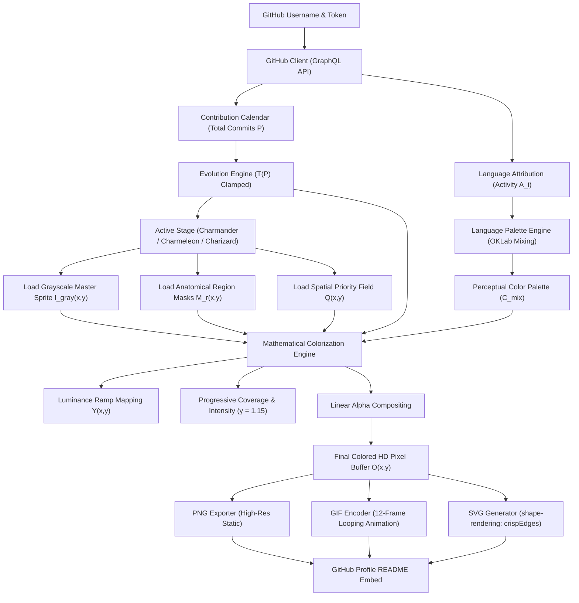

# Neo-Pokédex: System Architecture & Data Flow

## 1. Directory & Module Hierarchy

```text
neo-pokedex/
│
├── Cargo.toml                  # Pinned crate manifest & build profiles
├── Cargo.lock                  # Deterministic dependency lockfile
├── README.md                   # User-facing manual & setup guide
├── LICENSE                     # MIT License
│
├── .github/
│   └── workflows/
│       ├── ci.yml              # Formatter, Clippy, and test automation
│       └── pokedex-update.yml  # Daily profile generation & commit action
│
├── .agents/
│   └── skills/                 # 12 project-specific agent skills
│
├── assets/
│   ├── pokemon/
│   │   ├── charmander/
│   │   │   ├── master/charmander_gray.png
│   │   │   ├── masks/{body,belly,face,limbs,tail,flame}.png
│   │   │   └── palettes/default.toml
│   │   ├── charmeleon/
│   │   │   ├── master/charmeleon_gray.png
│   │   │   ├── masks/{body,belly,crest,arms,legs,tail,flame}.png
│   │   │   └── palettes/default.toml
│   │   └── charizard/
│   │       ├── master/charizard_gray.png
│   │       ├── masks/{body,belly,wings,membranes,limbs,tail,flame}.png
│   │       └── palettes/default.toml
│   └── palettes/
│       └── languages.toml      # Linguist brand colors & tonal parameters
│
├── config/
│   └── default.toml            # Application default settings
│
├── research/
│   ├── references/             # Visual reference galleries & Pokédex records
│   └── reports/                # Phase 0 research findings
│
├── src/
│   ├── main.rs                 # CLI binary entrypoint
│   ├── lib.rs                  # Core library crate roots
│   │
│   ├── github/                 # GitHub GraphQL API transport & caching
│   │   ├── mod.rs
│   │   ├── client.rs           # Reqwest GraphQL client with rustls
│   │   ├── contributions.rs    # Calendar parser & total aggregator
│   │   └── rate_limit.rs       # Backoff & token rate-limit supervisor
│   │
│   ├── language/               # Programming-language attribution
│   │   ├── mod.rs
│   │   ├── detection.rs        # Linguist extension & classifier tables
│   │   ├── attribution.rs      # User commit patch line attribution model
│   │   └── palette.rs          # Language color registry & fallbacks
│   │
│   ├── evolution/              # Evolution state machine
│   │   ├── mod.rs
│   │   ├── stages.rs           # Charmander, Charmeleon, Charizard definitions
│   │   └── progression.rs      # Clamped T(P) progression mathematics
│   │
│   ├── artwork/                # Master sprite & mask validation
│   │   ├── mod.rs
│   │   ├── loader.rs           # PNG asset reader & dimension checks
│   │   └── masks.rs            # Anatomical region mask bitmasks
│   │
│   ├── colorization/           # Mathematical colorization engine
│   │   ├── mod.rs
│   │   ├── engine.rs           # Orchestrator for pixel transformation
│   │   ├── luminance.rs        # Grayscale luminance Y(x,y) extraction
│   │   ├── tonal_ramp.rs       # 5-stop perceptual ramp generator
│   │   ├── priority_map.rs     # Spatial priority field Q(x,y)
│   │   ├── blending.rs         # OKLab & OKLCH weighted mixture
│   │   └── compositing.rs      # Alpha compositing & intensity curve
│   │
│   ├── renderer/               # Media generation
│   │   ├── mod.rs
│   │   ├── png.rs              # High-resolution 32-bit RGBA exporter
│   │   ├── gif.rs              # 12-frame animated loop encoder (10 FPS)
│   │   └── svg.rs              # Crisp-edge SVG markup generator
│   │
│   ├── config/                 # Strongly typed settings
│   │   ├── mod.rs
│   │   └── schema.rs           # Serde TOML configuration models
│   │
│   ├── cli/                    # Clap CLI definition
│   │   ├── mod.rs
│   │   └── commands.rs         # generate, preview, validate subcommands
│   │
│   └── errors/                 # Domain error taxonomy
│       ├── mod.rs
│       └── types.rs            # PokedexError enum with thiserror
│
└── tests/
    ├── common/                 # Test helpers & mock servers
    ├── evolution_tests.rs      # Threshold boundary tests
    ├── colorization_tests.rs   # Mathematical ramp & pixel-diff tests
    ├── language_tests.rs       # Attribution & palette mixture tests
    └── integration_tests.rs    # End-to-end pipeline verification
```

---

## 2. End-to-End Data Flow Pipeline



---

## 3. Core Architectural Subsystems

### 1. Data Ingestion & Sanitization (`src/github`)
- Communicates with GitHub's GraphQL v4 endpoint using non-blocking asynchronous `reqwest`.
- Employs an exponential backoff supervisor for HTTP 403 / 429 rate-limiting responses.
- Sanitizes all log events to guarantee personal access tokens are never leaked to logs or stdout.

### 2. Evolution & State Calculation (`src/evolution`)
- Pure, side-effect-free functional module.
- Maps $P \to (\text{Stage}, T(P))$, guaranteeing boundary safety:
  - Inputs below zero clamp to 0.
  - Inputs above the tier ceiling clamp to 1.0.

### 3. Mathematical Colorization (`src/colorization`)
- Transforms master grayscale pixel values using a 5-stop perceptual tonal ramp in OKLab color space.
- Applies spatial priority maps $Q(x,y)$ to grow organic colored clusters rather than salt-and-pepper noise.
- Combines language palette influence with authentic character base colors using region-specific blend factors $B_r$.

### 4. Asset Rasterization & Encoding (`src/renderer`)
- Encodes animated GIFs with a fixed 12-frame breathing and flame flicker loop.
- Employs NeuQuant color quantization to generate a global 256-color palette across all frames, preventing inter-frame dithering jitter.
