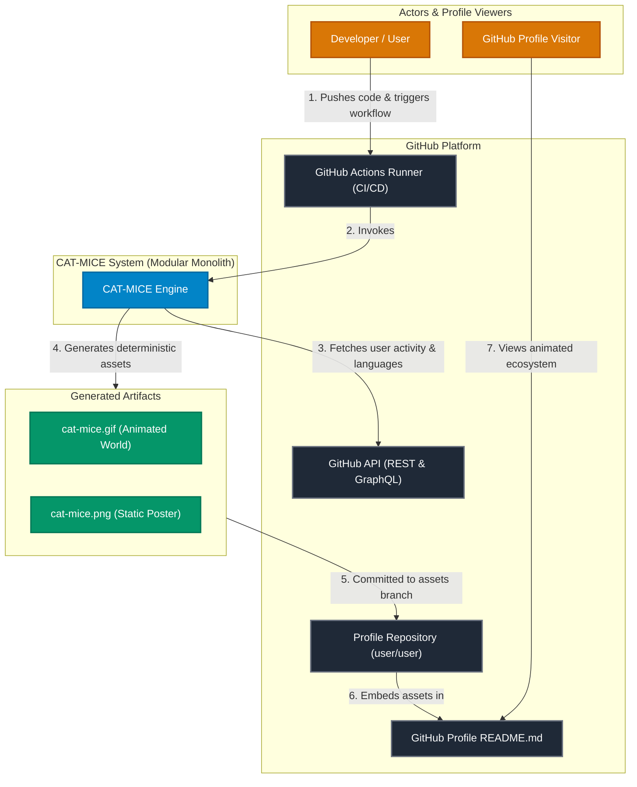
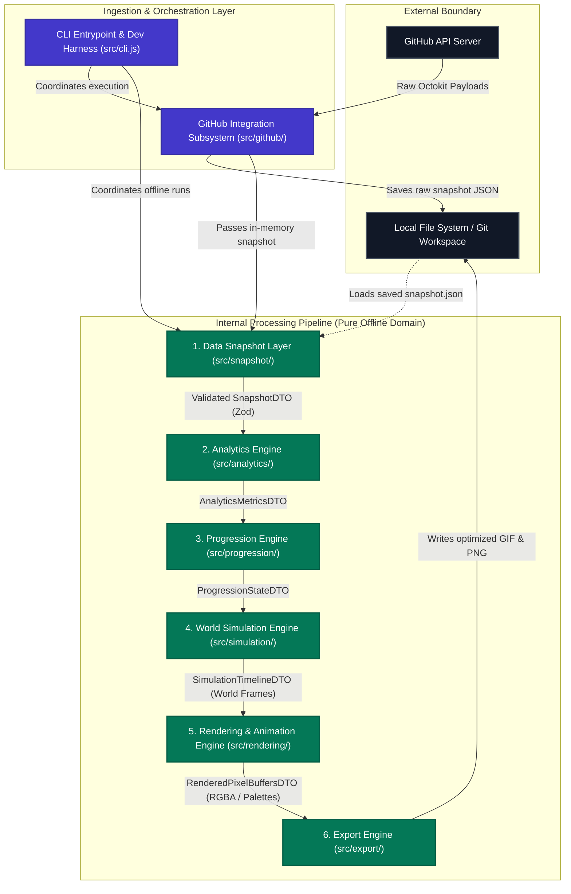
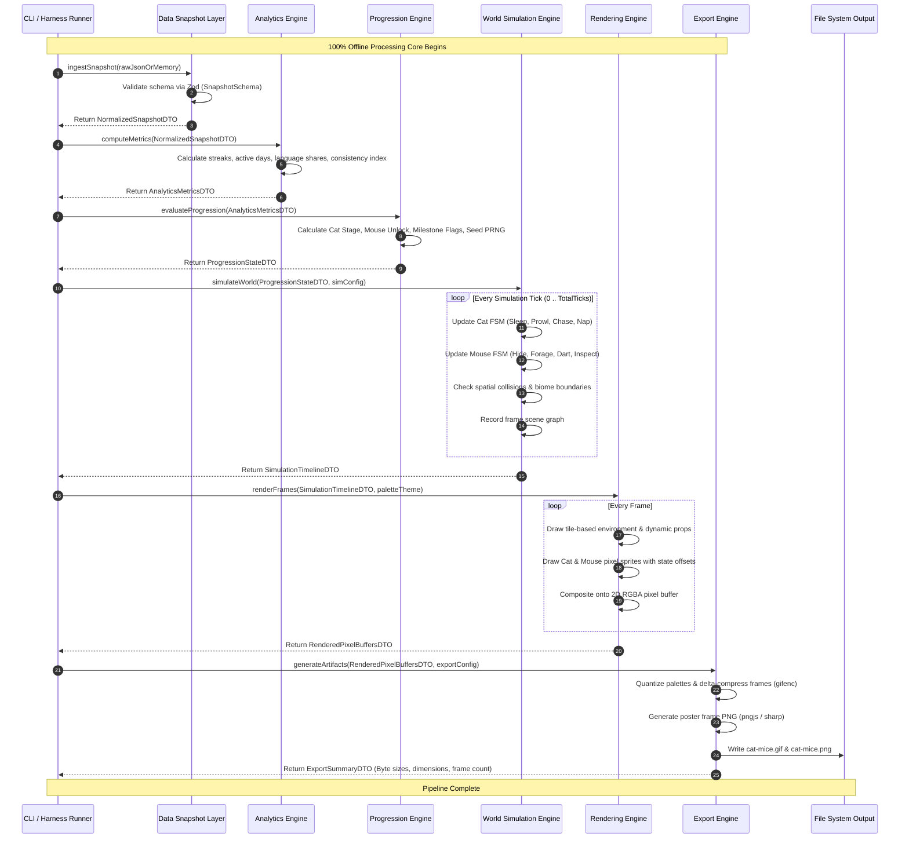
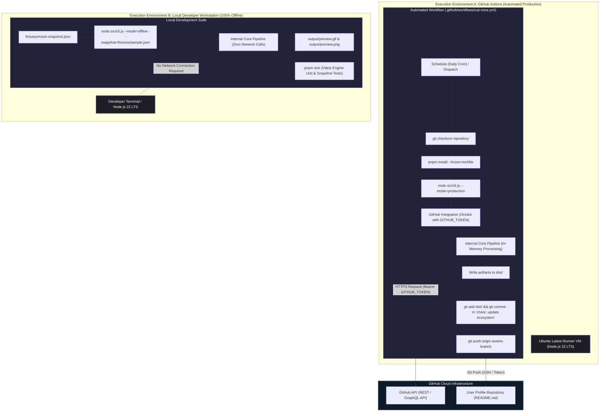

# CAT-MICE — High-Level System Architecture (HLA) Specification

**Document Version:** 1.0.0  
**Status:** Approved Architectural Baseline  
**System Classification:** Modular Monolith / Data-Driven Procedural Simulation  
**Target Runtime:** Node.js 22 LTS (Pure JavaScript ES Modules)

---

## 1. Executive Summary & Architecture Overview

**CAT-MICE** is a procedural pixel-art ecosystem generator that transforms a developer's GitHub contribution history, streaks, and programming language distributions into an animated, deterministic, retro pixel-art simulation displayed directly on a GitHub Profile README.

### 1.1 Core System Concept

- **The Cat:** Scales in growth, developmental milestones, and visual presence based on lifetime GitHub contributions.
- **The Mouse:** Unlocks only after the cat reaches a configurable maturity threshold; its speed, agility, and behavioral confidence evolve independently based on the developer's consistency (streaks and activity cadence).
- **The World:** A dynamic tile-based pixel canvas styled procedurally by the developer's top programming languages (e.g., Python emerald biomes, TypeScript azure accents, Rust terracotta elements).
- **The Output:** Highly optimized, loop-timed animated GIF and high-resolution poster PNG generated deterministically in GitHub Actions and committed to the profile repository.

### 1.2 Architectural Paradigm

The system is architected as a **Modular Monolith with a Data-Driven Processing Pipeline**:

1. **Strictly Decoupled Ingestion:** GitHub API calls are completely isolated within a dedicated integration layer that outputs an immutable, normalized **Data Snapshot**.
2. **Zero-Network Internal Core:** All analytics, character progression, spatial simulation, rasterization, and encoding run 100% offline without network calls or external daemon dependencies.
3. **Pure State Transitions:** Data moves strictly unidirectionally through pipeline phases:
   $$\text{Data Snapshot} \longrightarrow \text{Analytics} \longrightarrow \text{Progression} \longrightarrow \text{World Simulation} \longrightarrow \text{Rendering} \longrightarrow \text{Export}$$
4. **Deterministic Reproducibility:** Given the same data snapshot and seed, the simulation and render engines generate identical pixel matrices byte-for-byte across local developer workstations and CI/CD runners.

---

## 2. Technology Constraints & Rationale

| Layer                   | Selected Technology                                | Architectural Rationale & Boundary Constraints                                                                                                            |
| :---------------------- | :------------------------------------------------- | :-------------------------------------------------------------------------------------------------------------------------------------------------------- |
| **Runtime Environment** | **Node.js 22 LTS**                                 | Native support for ES Modules, top-level `await`, modern `fetch`, high-performance V8 engine, and native `crypto.webcrypto`.                              |
| **Module System**       | **JavaScript ESM**                                 | Native ECMAScript standard (`"type": "module"`). Avoids compilation overhead and transpilation discrepancies. No TypeScript or Babel build step required. |
| **Package Manager**     | **pnpm**                                           | Fast, deterministic content-addressable dependency resolution with minimal disk footprint and strict workspace isolation.                                 |
| **API Client**          | **Octokit** (`@octokit/rest` / `@octokit/graphql`) | Industry standard for GitHub API interaction, providing built-in rate-limiting resilience, pagination plugins, and authentication handling.               |
| **Contract Validation** | **Zod**                                            | Runtime schema validation at boundary layers (API responses, snapshot JSON files, configuration presets) guaranteeing type safety in pure JS.             |
| **Frame Rasterization** | **pngjs**                                          | Low-level, pure-JS pixel buffer manipulation and 2D canvas pixel synthesis without native binary compile dependencies.                                    |
| **GIF Encoding**        | **gifenc**                                         | Fast, lightweight, pure-JS animated GIF encoder supporting NeuQuant color quantization, custom palettes, transparency, and delta frames.                  |
| **Image Processing**    | **sharp**                                          | High-performance libvips wrapper used exclusively in the Export Engine for post-processing, static PNG compression, and asset resizing.                   |
| **Testing Harness**     | **Vitest**                                         | Blazing-fast unit and snapshot testing with native ESM support, fixture loading, and in-memory execution.                                                 |
| **Code Quality**        | **ESLint & Prettier**                              | Enforces functional cleanliness, strict ESM imports, and consistent code formatting across the repository.                                                |
| **Orchestration / CI**  | **GitHub Actions**                                 | Headless automated workflow scheduled via cron or dispatch; handles snapshot capture, pipeline execution, and git commit push.                            |

### Strict Negative Constraints

- ❌ **No Rust / Native Addons:** Avoids cross-compilation failures on different runner operating systems.
- ❌ **No TypeScript:** Zero compilation lag; contracts are enforced at runtime via Zod schemas and checked via JSDoc if desired.
- ❌ **No Microservices or Server Daemons:** Single-process modular monolith minimizing operational overhead.
- ❌ **No External Database:** Snapshot files (`.json`) and repository git history serve as the single source of truth.
- ❌ **No Non-Deterministic AI Behaviors:** All character intelligence is powered by deterministic Finite State Machines (FSM) and Seeded Pseudo-Random Number Generators (PRNG).

---

## 3. High-Level Architecture Diagrams

### 3.1 Diagram 1: System Context (C4 Context)



---

### 3.2 Diagram 2: High-Level Container & Component Architecture



---

### 3.3 Diagram 3: Internal Processing Pipeline Flow



---

### 3.4 Diagram 4: Detailed Data Flow Architecture

```mermaid
flowchart TD
    subgraph Stage1 ["Stage 1: Raw Ingestion"]
        RAW_GH["GitHub REST & GraphQL API Responses"]
        SNAP_FILE["fixtures/snapshot-2026.json (Offline Fixture)"]
    end

    subgraph Stage2 ["Stage 2: Validation & Snapshot Normalization"]
        ZOD["Zod Schema Validator (SnapshotSchema)"]
        NORM_SNAP["NormalizedSnapshotDTO\n• accountId: string\n• userLogin: string\n• contributions: ContributionDays[]\n• languages: LanguageUsage[]\n• snapshotTimestamp: ISOString"]
    end

    subgraph Stage3 ["Stage 3: Analytics Transformation"]
        ANALYTICS_PROC["Analytics Engine Calculus"]
        ANALYTICS_DATA["AnalyticsMetricsDTO\n• totalContributions: number\n• currentStreak: number\n• longestStreak: number\n• consistencyScore: 0.0 .. 1.0\n• topLanguages: [name, ratio][]\n• primaryHue: number (0-360)"]
    end

    subgraph Stage4 ["Stage 4: Progression Derivation"]
        PROGRESSION_PROC["Progression FSM & PRNG Seeder"]
        PROG_DATA["ProgressionStateDTO\n• cat: { stage: KITTEN|ADULT|ELDER, scale: 1x|2x, variant: string }\n• mouse: { unlocked: boolean, level: SCOUT|NINJA, speedMod: number }\n• worldSeed: number\n• environmentTheme: ThemeSpec"]
    end

    subgraph Stage5 ["Stage 5: World Simulation"]
        SIM_LOOP["Deterministic 60-Tick Simulation Loop"]
        SIM_FRAMES["SimulationTimelineDTO\n• frames: FrameState[\n    { tick: number, catPos: {x,y}, catAction, mousePos: {x,y}, mouseAction, props }\n  ]"]
    end

    subgraph Stage6 ["Stage 6: Pixel Rasterization"]
        RASTER_PROC["Sprite Matrix Blitter & Environment Composer"]
        PIXEL_BUFFERS["RenderedPixelBuffersDTO\n• width: 240, height: 120\n• frameBuffers: Uint8ClampedArray[] (RGBA)\n• fps: 10\n• loopCount: 0 (Infinite)"]
    end

    subgraph Stage7 ["Stage 7: Encoding & Export"]
        GIFENC["gifenc: Quantization & NeuQuant Palette Encoding"]
        SHARP_ENC["sharp / pngjs: Clean Poster PNG Generation"]
        FINAL_GIF["cat-mice.gif (Target < 800 KB)"]
        FINAL_PNG["cat-mice.png (Crisp Static Fallback)"]
    end

    %% Connections
    RAW_GH --> ZOD
    SNAP_FILE --> ZOD
    ZOD --> NORM_SNAP
    NORM_SNAP --> ANALYTICS_PROC
    ANALYTICS_PROC --> ANALYTICS_DATA
    ANALYTICS_DATA --> PROGRESSION_PROC
    PROGRESSION_PROC --> PROG_DATA
    PROG_DATA --> SIM_LOOP
    SIM_LOOP --> SIM_FRAMES
    SIM_FRAMES --> RASTER_PROC
    RASTER_PROC --> PIXEL_BUFFERS
    PIXEL_BUFFERS --> GIFENC
    PIXEL_BUFFERS --> SHARP_ENC
    GIFENC --> FINAL_GIF
    SHARP_ENC --> FINAL_PNG

    classDef dataBox fill:#0f172a,stroke:#38bdf8,stroke-width:1.5px,color:#f8fafc;
    classDef procBox fill:#1e293b,stroke:#a855f7,stroke-width:1.5px,color:#f8fafc;
    classDef finalBox fill:#064e3b,stroke:#34d399,stroke-width:2px,color:#f8fafc;

    class NORM_SNAP,ANALYTICS_DATA,PROG_DATA,SIM_FRAMES,PIXEL_BUFFERS dataBox;
    class ZOD,ANALYTICS_PROC,PROGRESSION_PROC,SIM_LOOP,RASTER_PROC,GIFENC,SHARP_ENC procBox;
    class FINAL_GIF,FINAL_PNG finalBox;
```



---

### 3.5 Diagram 5: Deployment & Operational Runtime Architecture



---

## 4. Component Responsibility Specification

The system is decomposed into cleanly isolated, single-responsibility modules:

```
cat-mice/
├── src/
│   ├── cli.js                  # CLI harness & command line router
│   ├── github/                 # Ingestion & external GitHub API connector
│   ├── snapshot/               # Validation & snapshot normalization layer
│   ├── analytics/              # Contribution & language metrics calculus
│   ├── progression/            # Character maturation & milestone rules
│   ├── simulation/             # 2D world spatial simulation & state machine
│   ├── rendering/              # Sprite blitting, palettes, & frame rasterization
│   └── export/                 # GIF quantization & PNG file writer
├── fixtures/                   # Static test snapshots for offline execution
├── test/                       # Vitest unit & integration test suites
└── package.json
```

### 4.1 Component Responsibility Table

| Component                                           | Responsibility                                                                                                                        | Inputs                                           | Outputs                                          | Allowed Dependencies                    | Boundaries & Prohibitions                                                                                                     |
| :-------------------------------------------------- | :------------------------------------------------------------------------------------------------------------------------------------ | :----------------------------------------------- | :----------------------------------------------- | :-------------------------------------- | :---------------------------------------------------------------------------------------------------------------------------- |
| **GitHub Integration** (`src/github/`)              | Communicates with GitHub API, handles pagination, rate limits, and network errors. Generates raw snapshot object.                     | GitHub username, Auth token, API endpoints       | `RawGitHubData` object or writes `snapshot.json` | Octokit, native `fetch`                 | **Strict Boundary:** Never imports analytics, progression, simulation, or rendering engines. Only called by CLI/Orchestrator. |
| **Data Snapshot Layer** (`src/snapshot/`)           | Validates arbitrary input against strict schemas, sanitizes fields, ensures default values, produces immutable normalized DTOs.       | Raw JSON or memory object                        | `NormalizedSnapshotDTO`                          | `zod`                                   | Must function identically whether data came from network or static fixture. No network calls.                                 |
| **Analytics Engine** (`src/analytics/`)             | Calculates mathematical developer metrics: streaks, active days, language percentages, consistency coefficients.                      | `NormalizedSnapshotDTO`                          | `AnalyticsMetricsDTO`                            | Math utils, Date-fns/native Date        | Zero awareness of characters (cats or mice). Deals only with numbers, ratios, and dates.                                      |
| **Progression Engine** (`src/progression/`)         | Translates analytical metrics into game domain progression: Cat maturity, Mouse unlock, movement traits, world themes.                | `AnalyticsMetricsDTO`, GameConfig                | `ProgressionStateDTO`                            | Deterministic PRNG utility              | Pure logic. No graphics, pixels, or simulation tick loops.                                                                    |
| **World Simulation Engine** (`src/simulation/`)     | Runs a discrete 2D spatial simulation over $N$ ticks. Manages collision, bounds, behaviors (FSM), and character interactions.         | `ProgressionStateDTO`, SimConfig                 | `SimulationTimelineDTO`                          | Spatial math utils                      | Zero rendering or encoding dependencies. Outputs abstract coordinates and action states per tick.                             |
| **Rendering & Animation Engine** (`src/rendering/`) | Generates pixel-art graphics. Blits character sprites, draws dynamic tile environments, and applies color themes onto pixel matrices. | `SimulationTimelineDTO`, ThemeSpec               | `RenderedPixelBuffersDTO` (RGBA arrays)          | `pngjs` (in-memory buffer manipulation) | Does not write files to disk. Does not perform GIF compression or quantization.                                               |
| **Export Engine** (`src/export/`)                   | Color quantization (NeuQuant), frame delta compression, GIF creation, static poster generation, and physical disk I/O.                | `RenderedPixelBuffersDTO`, OutputConfig          | `cat-mice.gif`, `cat-mice.png`, File Summary     | `gifenc`, `sharp`, `node:fs/promises`   | Agnostic to GitHub or game rules. Simply receives raw pixel frames and encodes them.                                          |
| **CLI & Local Dev Harness** (`src/cli.js`)          | Coordinates workflow execution mode (live vs. offline), wires components together, provides developer feedback.                       | CLI arguments (`--mode`, `--snapshot`, `--seed`) | Process status & pipeline invocation             | All components (composition root)       | Acts strictly as the orchestrator/assembler (Composition Root). Contains no business logic.                                   |

---

## 5. Architectural Deep Dives & Data Contracts

### 5.1 Snapshot Contract Schema (Zod)

Every pipeline execution must be initiated with a validated payload satisfying the `SnapshotSchema`:

```javascript
// src/snapshot/schema.js
import { z } from "zod";

export const ContributionDaySchema = z.object({
  date: z.string().regex(/^\d{4}-\d{2}-\d{2}$/),
  contributionCount: z.number().int().nonnegative(),
  color: z.string().optional()
});

export const LanguageUsageSchema = z.object({
  name: z.string(),
  bytes: z.number().int().nonnegative(),
  color: z
    .string()
    .regex(/^#[0-9a-fA-F]{6}$/)
    .optional()
});

export const SnapshotSchema = z.object({
  version: z.literal(1),
  timestamp: z.string().datetime(),
  user: z.object({
    login: z.string().min(1),
    id: z.string().min(1),
    createdAt: z.string().datetime()
  }),
  metrics: z.object({
    totalContributions: z.number().int().nonnegative(),
    calendarDays: z.array(ContributionDaySchema),
    languages: z.array(LanguageUsageSchema)
  })
});
```

### 5.2 Deterministic Pseudo-Random Number Generation (PRNG)

To ensure that generated animations are deterministic across identical data, CAT-MICE prohibits `Math.random()`. The Progression and Simulation engines utilize a **Mulberry32** or **Linear Congruential Generator (LCG)** seeded by hashing the user's `id` and current calendar week:

$$\text{Seed} = \text{hash32}(\text{user.id} + \text{currentWeekIdentifier})$$

This guarantees:

1. Two runs on the same day for the same user yield identical animations.
2. A subtle shift in behavior occurs naturally as new contributions are recorded or the week advances.
3. Local offline previews with a fixed seed match production bit-for-bit.

### 5.3 Finite State Machines (FSM) in World Simulation

Characters move through discrete states governed by deterministic transition rules:

```
[Cat States]:
  SLEEPING  --> (Activity threshold reached) --> PROWLING
  PROWLING  --> (Mouse detected in range)   --> STALKING
  STALKING  --> (Distance < StrikeZone)     --> POUNCING
  POUNCING  --> (Cooldown elapsed)          --> GROOMING
  GROOMING  --> (Timer expired)             --> SLEEPING / PROWLING

[Mouse States] (Unlocked only if Cat Stage >= ADULT):
  HIDDEN    --> (Cat sleeping / distant)    --> FORAGING
  FORAGING  --> (Cat pounces / approaches)  --> DARTING
  DARTING   --> (Reached burrow boundary)   --> HIDDEN
  INSPECT   --> (High consistency score)    --> TAUNTING
```

---

## 6. Architecture Decision Records (ADRs)

### ADR-01: Modular Monolith in Pure JavaScript ESM (No TypeScript)

- **Status:** Accepted.
- **Context:** The system needs high velocity, simplicity, and low barrier to contribution. Node.js 22 LTS natively supports modern ES Modules.
- **Decision:** Write pure ES Modules (`import`/`export`) without TypeScript or compilation build steps. Use `Zod` schemas at boundary interfaces for type safety.
- **Consequences:** Eliminates `tsc` build time, `tsconfig.json` maintenance, and source-map mismatches. Eliminates TypeScript transpilation artifacts.

### ADR-02: Isolated Data Snapshot as the Universal Boundary

- **Status:** Accepted.
- **Context:** Coupling the simulation directly to GitHub API calls prevents local testing, risks rate-limiting during UI tweaks, and makes automated testing slow and brittle.
- **Decision:** GitHub Integration produces a standardized `snapshot.json`. The entire simulation engine accepts this snapshot as its sole input.
- **Consequences:** Local development runs instantly using saved snapshots without credentials. Vitest unit tests run offline in milliseconds.

### ADR-03: In-Memory Pure-JS Rasterization via `pngjs` and `gifenc`

- **Status:** Accepted.
- **Context:** Traditional graphic synthesis in Node.js often relies on Canvas (`node-canvas`), which requires native C++ bindings (`cairo`, `pango`, `giflib`), frequently failing to install on various developer operating systems.
- **Decision:** Use `pngjs` for 2D pixel buffer operations and `gifenc` for color quantization and animated GIF encoding.
- **Consequences:** Completely pure JavaScript dependencies. Zero native build tools (no `node-gyp`, no Python, no OS-level graphics libraries) needed on local dev or CI.

### ADR-04: Stateless File-Based Output Storage

- **Status:** Accepted.
- **Context:** Running a persistent database (PostgreSQL, SQLite, Redis) introduces infrastructure management, hosting costs, and connection vulnerabilities.
- **Decision:** Treat the GitHub repository itself as storage. The generated `.gif` and `.png` are written to a designated distribution directory (`dist/`) and committed directly to the git branch.
- **Consequences:** Zero infrastructure costs, 100% uptime, zero operational maintenance.

---

## 7. Operational & Execution Scenarios

### 7.1 Production Mode (GitHub Actions)

```bash
# Automated run inside GitHub Actions Runner
node src/cli.js --mode=production --user=octocat --out=dist/
```

1. Octokit retrieves contribution history and top repo languages using `GITHUB_TOKEN`.
2. Validates and generates an in-memory `NormalizedSnapshotDTO`.
3. Runs the internal pipeline (Analytics → Progression → Sim → Render → Export).
4. Writes `dist/cat-mice.gif` and `dist/cat-mice.png`.
5. GitHub Action commits and pushes the updated artifacts to the repository.

### 7.2 Local Development & Offline Debugging

```bash
# Offline execution using a captured fixture (No GitHub token or network needed)
node src/cli.js --mode=offline --snapshot=fixtures/high-streak.json --out=output/
```

1. Reads `fixtures/high-streak.json` from the filesystem.
2. Directly invokes the internal pipeline starting at `Data Snapshot Layer`.
3. Emits `output/cat-mice.gif` in under 1.5 seconds.
4. Allows designers to tweak sprite palettes, physics, and frame rates in real-time.

---

## 8. Scalability, Performance & Resource Budgets

| Metric                     | Target Budget                           | Mitigation Strategy                                                                                                                                                       |
| :------------------------- | :-------------------------------------- | :------------------------------------------------------------------------------------------------------------------------------------------------------------------------ |
| **GitHub Actions Runtime** | **< 20 seconds** total execution        | Pure-JS memory pipeline; no compilation; lightweight simulation (60-120 ticks max).                                                                                       |
| **Output GIF File Size**   | **< 800 KB** (Ideal: 350-500 KB)        | 64-color global palette quantization via `gifenc`; delta frame encoding (only changing pixels re-drawn); retro canvas resolution (120x60 upscaled to 240x120 or 480x240). |
| **Memory Footprint**       | **< 128 MB RAM**                        | Reusable `Uint8ClampedArray` frame buffers; garbage collection friendly structures.                                                                                       |
| **GitHub API Quota**       | **1 GraphQL query** or max 2 REST calls | Single GraphQL query retrieves lifetime contributions and repository languages simultaneously, consuming only 1 point of the 5,000/hr quota.                              |

---

## 9. Failure Modes & Architectural Mitigations

1. **GitHub API Outage or Token Expiry:**
   - _Behavior:_ Network request fails in GitHub Integration layer.
   - _Mitigation:_ The workflow detects the network error, logs a clean diagnostic message, and exits gracefully without overwriting existing assets in `dist/`. The profile README continues displaying the last successful GIF.
2. **Account with Zero Contributions (Brand New User):**
   - _Behavior:_ Snapshot yields empty contribution arrays.
   - _Mitigation:_ The Analytics Engine provides fallback defaults: Cat is initialized in `KITTEN` stage, mouse remains `LOCKED`, and the environment renders a cozy nursery scene.
3. **Extreme Contribution Outliers (> 10,000 commits):**
   - _Behavior:_ Metric scaling could cause sprite overflow or unbounded growth.
   - _Mitigation:_ Progression formulas utilize logarithmic clamping:
     $$\text{GrowthPoints} = \min\left(\text{MaxPoints}, \log_2(1 + \text{contributions}) \times K\right)$$

---

## 10. Architecture Validation Checklist

- [x] **Boundary Isolation:** GitHub Integration is completely decoupled from the internal engines.
- [x] **100% Offline Capability:** The complete pipeline executes from a local JSON fixture without network access.
- [x] **Explicit Contract Layer:** Zod schema validation guards all snapshot data entering the pipeline.
- [x] **Deterministic Logic:** PRNG replaces `Math.random()` to ensure pixel-perfect reproducible renders.
- [x] **Lightweight Runtime:** Node.js 22 LTS with pure JS modules (no TypeScript compilation, no Rust, no C++ bindings).
- [x] **Consistent Diagrams:** All 5 Mermaid diagrams strictly conform to the container boundaries, data flow rules, and component specs.
- [x] **Zero Server / Zero Database:** Serverless operational profile deployed directly via GitHub Actions.
