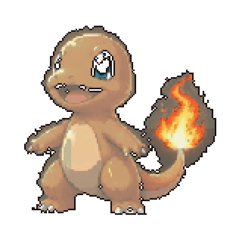
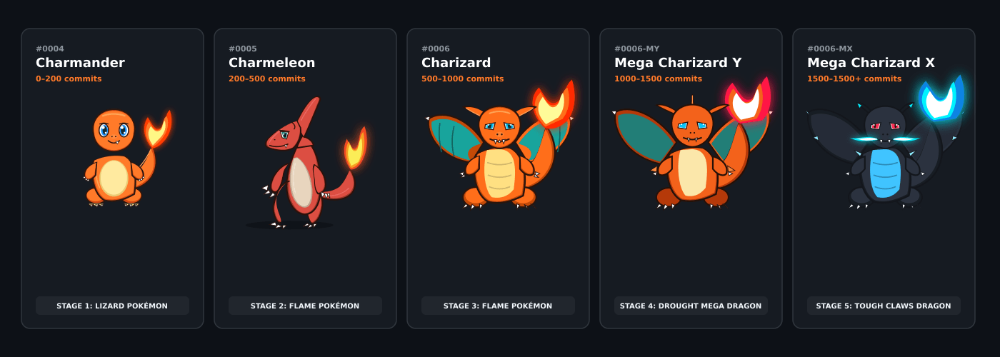
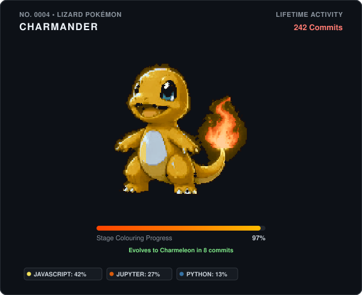

# GitHub Pokémon Evolution Companion

> An interactive, contribution-powered Pokémon evolution companion in a modern 2.5D anime aesthetic.

<!-- POKEMON-EVOLUTION:START -->
<p align="center">
  
</p>

<p align="center">
  <strong>Current Form:</strong> Charmeleon (No. 0005) &nbsp;|&nbsp;
  <strong>Lifetime Activity:</strong> 228 contributions &nbsp;|&nbsp;
  <strong>Stage Colouring:</strong> 9%
</p>
<p align="center">
  <em>28 / 300 contributions to evolve</em>
</p>
<!-- POKEMON-EVOLUTION:END -->

<p align="center">
  <a href="./assets/generated/pokemon-evolution.svg">
    
  </a>
  
  
  
  
</p>

---

## 5-Stage Evolution Progression System

Your lifetime GitHub contributions progressively color your companion. Reaching exact contribution milestones triggers evolution transitions through five distinct, iconic forms:

<p align="center">
  
</p>

| Stage | Pokémon              | Lifetime Contributions |      Target Requirement      | Visual Characteristics                                                                          |
| :---: | :------------------- | :--------------------: | :--------------------------: | :---------------------------------------------------------------------------------------------- |
| **1** | **Charmander**       |        0 – 199         |         200 commits          | Visibly small lizard companion, gentle anime eyes, tail flame burns brighter with activity.     |
| **2** | **Charmeleon**       |       200 – 499        |         300 commits          | Ruby crimson red scales, prominent skull horn, razor claws, and agitated fiery intensity.       |
| **3** | **Charizard**        |       500 – 999        |         500 commits          | Full majestic dragon form, broad wings with teal membranes, twin horns, and roaring tail flame. |
| **4** | **Mega Charizard Y** |     1,000 – 1,499      |         500 commits          | Streamlined drought dragon, triple horn crest, jagged aerodynamic wings, and wrist winglets.    |
| **5** | **Mega Charizard X** |         1,500+         | Repeatable Mastery (500/lvl) | Formidable obsidian slate armor, cyan-blue horns & belly plates, and blazing blue mouth flames. |

> [!NOTE]
> Lifetime contributions never reset upon evolution. Each new stage begins 100% monochrome, with contributions progressively filling its independent anatomical regions.

---

## Mathematical Progressive Colouring Engine

Rather than applying a crude global opacity filter, CAT-MICE implements an **area-weighted, anatomically sequenced, mathematically deterministic progressive colouring engine**.

```
            Tail Flame (Priority 1) ───► Head & Horns (Priority 2)
                       │                              │
                       ▼                              ▼
                 Torso & Belly (Priority 3) ───► Wings & Membranes (Priority 4)
                                                       │
                                                       ▼
                                            Arms, Legs & Claws (Priority 5-7)
```

### Global Colouring Formula

$$\text{Colouring Progress } (P) = 100 \times \sum_{i} \left( \text{weight}_i \times \text{completion}_i \right)$$

- **Area Weights:** Every form is partitioned into discrete anatomical SVG geometry regions with measured weights summing to exactly $1.00$ ($100\%$).
- **Smoothstep Transitions:** Partial region color propagation uses cubic Hermite interpolation:
  $$S(t) = t^2 \times (3 - 2t) \quad \text{for } t \in [0, 1]$$
- **Cel-Shading Reveal:** Base colors, ambient shadows, and specular highlights spread progressively through each region, culminating in full color before transitioning to the next anatomical region.

---

## Add to Your GitHub Profile README

### Option A: Direct Embed (Instant 10-Second Setup)

Add this snippet to your profile `README.md` (`USERNAME/USERNAME`):

```markdown
<!-- Living Looping Animated GIF -->
<p align="center">
  
</p>

<!-- Or Scalable Resolution-Independent SVG -->
<p align="center">
  
</p>
```

---

### Option B: Automatic GitHub Action in Your Own Repository

Create `.github/workflows/pokemon-evolution.yml` in your profile repository:

```yaml
name: Generate Pokémon Evolution Companion

on:
  schedule:
    # Runs daily at midnight UTC
    - cron: "0 0 * * *"
  workflow_dispatch:
  push:
    branches: [main]

permissions:
  contents: write

jobs:
  generate:
    runs-on: ubuntu-latest
    steps:
      - uses: actions/checkout@v4
      - uses: jeevansurya560-arch/Cat-Mice@main
        with:
          user: ${{ github.repository_owner }}
          out: "assets/generated"
          readme: "README.md"
          social: "true"
      - name: Push updates
        run: |
          git config --global user.name "github-actions[bot]"
          git config --global user.email "41898282+github-actions[bot]@users.noreply.github.com"
          git add -f assets/ README.md dist/
          git diff --staged --quiet || (git commit -m "chore(pokemon): update evolution companion" && git push)
```

---

## LinkedIn Presentation Package

For showcasing your engineering work on LinkedIn, the engine automatically generates publication-ready assets:

| Asset               | Path                                                                           | Specifications                                                    |
| :------------------ | :----------------------------------------------------------------------------- | :---------------------------------------------------------------- |
| **Social Preview**  | [`assets/social/linkedin-preview.png`](assets/social/linkedin-preview.png)     | 1200 × 627 px high-res presentation card with evolution timeline. |
| **Evolution Board** | [`assets/social/evolution-showcase.png`](assets/social/evolution-showcase.png) | 1400 × 500 px side-by-side comparison of all 5 forms.             |
| **Post Draft**      | [`assets/social/linkedin-post.md`](assets/social/linkedin-post.md)             | Ready-to-copy post draft with technical highlights and hashtags.  |

---

## Local Development & CLI

Run the full companion offline with zero tokens or network requests:

```bash
# Clone the repository
git clone https://github.com/jeevansurya560-arch/Cat-Mice.git
cd Cat-Mice

# Install dependencies
pnpm install

# Build all production artifacts (SVG, GIF, and LinkedIn assets)
pnpm build

# Preview all 5 evolution stages in the console
pnpm preview

# Run CLI with arbitrary contribution milestones
node src/cli.js --mode=offline --contributions=750 --details
node src/cli.js --mode=offline --contributions=1250 --details
node src/cli.js --mode=offline --contributions=1800 --social
```

### Run Automated Quality Assurance

```bash
# Run unit & mathematical regression test suite
pnpm test

# Run ESLint inspection
pnpm lint

# Check code formatting
pnpm format:check
```

---

## License

[MIT](LICENSE) © 2026 Suryaaa..
