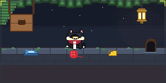
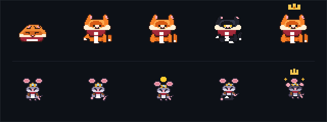

# Cat & Mice

> A living pixel-art cat and consistency companion mouse driven by your GitHub activity.

Cat & Mice draws a pixel-art cat and consistency companion mouse from a GitHub account's public activity. Your languages color their world and coats, your contributions grow the cat, your streaks equip the companion mouse, and weekly activity drives their daily habits. A nightly workflow puts the living ecosystem directly on your profile README as an ultra-lightweight looping GIF, the same tool runs from the command line, and offline preview runs with zero credentials.

<p align="center">
  
</p>

<p align="center">
  
</p>

---

## Progression Matrix

| Growth Stage (Cat) | Total Contributions | Companion Tier (Mouse) | Active Streak  | Visual Evolution                                      |
| :----------------- | :------------------ | :--------------------- | :------------- | :---------------------------------------------------- |
| **🐱 Kitten**      | 0 – 50              | **🐭 Newbie**          | 0 – 15 days    | Cozy sleeping loaf & gentle lavender companion        |
| **🐱 Young**       | 51 – 250            | **🐭 Regular**         | 16 – 50 days   | Stepping forward & adventurous burrow forager         |
| **🐱 Adult**       | 251 – 1,000         | **🐭 Consistent**      | 51 – 150 days  | Attentive ginger cat & golden cheese collector        |
| **🐱 Pro**         | 1,001 – 2,500       | **🐭 Dedicated**       | 151 – 300 days | Ball batting, sleek midnight coat & coding on laptop  |
| **👑 Master**      | 2,501+              | **👑 Streaker**        | 301+ days      | Royal Golden Crown, Octocat emblem & radiant sparkles |

---

## The Living Ecosystem

```
             ┌────────────────────────────────────────────────────────┐
             │                      CAT & MICE                        │
             └────────────────────────────────────────────────────────┘
                      ▲                                      ▲
                      │                                      │
              [Total Contributions]                  [Streaks & Consistency]
                      │                                      │
                      ▼                                      ▼
             🐱 THE CAT (Growth)                    🐭 THE MOUSE (Companion)
             • Kitten (Curled sleeping loaf)        • Newbie (Peeking from burrow)
             • Young  (Stepping & exploring)        • Regular (Curious forager)
             • Adult  (Signature burgundy scarf)    • Consistent (Golden gear / cheese)
             • Pro    (Playful wool ball batting)   • Dedicated (Coding on laptop)
             • Master (Golden royal crown)          • Streaker (Aviator goggles & crown)
```

### Living World Interactions

- 🐟 **Fish & Fish Bones:** A fresh ocean-blue fish rests in a ceramic serving bowl. When the cat finishes eating, the fish disappears and clean skeleton bones remain.
- 🧶 **Wool Ball Physics:** The cat playfully pounces and bats the textured red yarn ball across the stone paver ledge with rebound momentum.
- 🧀 **Golden Swiss Cheese:** The mouse scurries out of its burrow to forage golden cheese wedges and proudly carry them overhead.
- 💻 **Companion Laptop:** The dedicated mouse sets up an ultra-thin slate laptop with a glowing white GitHub logo and codes alongside you.
- 🕳️ **Arched Stone Burrow:** An arched hideout built into the stone wall foundation where the companion rests, peeks, and naps.
- 🏮 **Warm Brass Lantern:** A hanging brass lantern casts radial golden ambient light over the mossy stone walkway at twilight.

---

## Add to Your GitHub Profile README

### 1. Add the GitHub Action Workflow

Create `.github/workflows/cat-mice.yml` in your profile repository (`username/username`):

```yaml
name: Generate Cat & Mice Ecosystem

on:
  schedule:
    # Runs daily at midnight UTC
    - cron: "0 0 * * *"
  workflow_dispatch:
  push:
    branches: [main]

permissions:
  contents: write

jobs:
  build:
    runs-on: ubuntu-latest
    steps:
      - uses: actions/checkout@v4

      - uses: pnpm/action-setup@v4
        with:
          version: 12

      - uses: actions/setup-node@v4
        with:
          node-version: 22
          cache: "pnpm"

      - run: pnpm install --frozen-lockfile

      - name: Generate Ecosystem
        env:
          GITHUB_TOKEN: ${{ secrets.GITHUB_TOKEN }}
        run: node src/cli.js --mode=production --user="${{ github.repository_owner }}" --out=dist --details

      - name: Commit and push changes
        run: |
          git config --global user.name "github-actions[bot]"
          git config --global user.email "41898282+github-actions[bot]@users.noreply.github.com"
          git add dist/cat-mice.gif dist/cat-mice.png dist/showcase.png
          if git diff --staged --quiet; then
            echo "No changes to commit."
          else
            git commit -m "chore(ecosystem): update cat-and-mouse world [skip ci]"
            git push
          fi
```

> [!TIP]
> Ensure **Settings $\to$ Actions $\to$ General $\to$ Workflow permissions** is set to **"Read and write permissions"** in your repository.

### 2. Embed in Your README.md

Add this snippet to your profile `README.md`:

```markdown
<p align="center">
  
</p>
```

---

## Local Development & CLI

Run the full ecosystem completely offline without GitHub tokens or network access:

```bash
# Clone the repository
git clone https://github.com/jeevansurya560-arch/Cat-Mice.git
cd Cat-Mice

# Install dependencies
pnpm install

# Run end-to-end build (generates dist/cat-mice.gif, dist/cat-mice.png, dist/showcase.png)
pnpm build

# Generate offline preview in output/
pnpm preview

# Run CLI with progression details
node src/cli.js --mode=offline --snapshot=fixtures/sample-snapshot.json --details
```

### Try Different Developer Profiles

```bash
# High streak developer (unlocked Ninja / Streaker mouse)
node src/cli.js --mode=offline --snapshot=fixtures/high-streak.json --details

# Polyglot developer (multi-language palette theme)
node src/cli.js --mode=offline --snapshot=fixtures/polyglot.json --details

# Brand new account (playful kitten nursery)
node src/cli.js --mode=offline --snapshot=fixtures/zero-contributions.json --details
```

---

## Architecture & Design Principles

- **Modular Monolith in Pure JavaScript ESM:** Built for Node.js 22 LTS with zero compilation overhead. No TypeScript, no Rust binaries, no server daemons.
- **Universal Boundary Isolation:** GitHub integration communicates solely through CLI orchestration. The entire internal pipeline (Analytics $\to$ Progression $\to$ Simulation $\to$ Rendering $\to$ Export) runs 100% offline.
- **Deterministic Mulberry32 PRNG:** Bit-for-bit reproducibility. Identical input snapshots yield identical animations across workstations and CI runners.
- **Ultra-Compact Asset Budget:** Employs NeuQuant color quantization and delta frame compression via `gifenc` to produce smooth, high-appeal 60-frame animations at **~200 KB** (far below GitHub's 800 KB ceiling).

For complete technical specifications, data contracts, and C4 architecture diagrams, see [ARCHITECTURE.md](ARCHITECTURE.md).

---

## Testing & Quality Assurance

```bash
# Run complete Vitest suite (103 tests across 29 test suites)
pnpm test

# Run ESLint
pnpm lint

# Run Prettier code formatting check
pnpm format:check
```

---

## License

[MIT](LICENSE) © 2026 Suryaaa..
